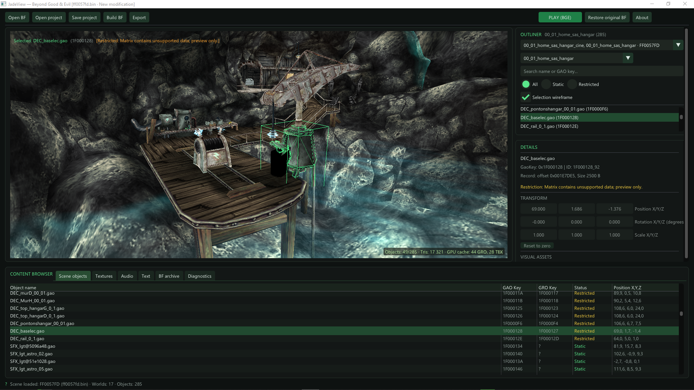

# JadeView - BGE Modding tool



[English version](README.md)

Автор: ARK [профиль в Discord](https://discord.com/users/355708121676644353). Проект опубликован с разрешения автора.

По вопросам обращайтесь на [сервер Discord](https://discord.gg/KYsaVU9rg).

Инструмент для моддинга **Beyond Good & Evil (2003, PC)** под Windows: просмотр ассетов, редактор сцен и сборка BF-архивов. Открывает `sally_clean.bf` в оригинальном формате BIG `0x22`; архивы HD-версии и консолей не поддерживаются.

## Статус функционала

| Функционал | Статус |
| --- | --- |
| Просмотр сцен и ресурсов | Работает |
| Экспорт GLB / PNG / WAV / JSON | Работает с ограничениями |
| Воспроизведение анимаций | Только распознанные акторы |
| Перемещение / вращение / добавление / копирование / удаление | Поддерживаемые статические объекты |
| Масштабирование | Только добавленные объекты |
| Проекты `.bgemod`, Undo/Redo | Работает |
| Сборка BF, запуск игры, восстановление архива | Реализовано; ограничения ниже |
| Полный импорт/замена ассетов, редактор мешей/материалов | Недоступно |
| Редактирование исходных акторов и иерархий | Не поддерживается |
| Манипуляторы вращения/масштаба, архивы HD/консолей | Не поддерживается |

## Запуск

Скачайте последнюю готовую сборку со страницы [GitHub Releases](https://github.com/karozero/jadeview/releases), распакуйте архив и запустите `JadeView.exe`. Выберите свой `sally_clean.bf` через **Open BF**.

## Сборка

Для сборки из исходного кода под **Windows x64** установите **.NET 10 SDK** на Windows, откройте терминал в папке проекта и выполните:

```powershell
dotnet publish JadeView.csproj -c Release -r win-x64 --self-contained false -o artifacts/publish/win-x64
```

Запускайте `JadeView.exe` из `artifacts/publish/win-x64`. Этот компактный пакет требует установленного **.NET 10 Desktop Runtime (x64)** на компьютере пользователя и содержит нативные зависимости только для Windows x64.

Для автономного пакета со встроенным .NET используйте отдельную папку:

```powershell
dotnet publish JadeView.csproj -c Release -r win-x64 --self-contained true -o artifacts/publish/win-x64-standalone
```

Автономный пакет больше по размеру, но не требует отдельной установки .NET. Распространяйте всё содержимое выбранной папки публикации, а не всю папку `bin`. Команда `dotnet publish` автоматически восстанавливает зависимости.

Чтобы запустить приложение из исходников с архивом игры, выполните:

```powershell
dotnet run --project JadeView.csproj -- "C:\Games\Beyond Good & Evil\sally_clean.bf"
```

Путь к архиву можно не указывать и выбрать его кнопкой **Open BF**.

## Использование

1. Откройте BF-архив. Выберите сцену и, если доступно, мир в **Outliner**. Также можно дважды щёлкнуть по FF0-контейнеру в каталоге архива.
2. Выберите объект во вьюпорте или Outliner. Его ресурсы и трансформация показаны в **Details**; текстуры, звук, тексты и диагностика доступны в нижней панели.
3. Перемещайте поддерживаемые статические объекты манипулятором или через поля позиции; меняйте вращение в **Details**. Для добавленных объектов также доступно масштабирование. Масштабирование и редактирование исходных скелетных, анимированных и дочерних объектов сейчас отключены.
4. Кнопка **Add object** в Outliner добавляет геометрию текущей сцены или FIX. В контекстном меню статического объекта доступны копирование и удаление. Эти изменения сцены и их трансформации сохраняются в `.bgemod`; доступны Undo/Redo.
5. **Save project** сохраняет `.bgemod`, **Open project** открывает его. **Build BF** записывает трансформации, добавленные экземпляры геометрии, копии статических объектов и удаления в отдельный архив. Перед сохранением редактор пересобирает и повторно разбирает поток зависимостей FF0; исходный архив сохраняется.

При удалении коллизионной геометрии карты экспорт отключает распознанные контроллеры скрытия групп секторов в затронутом мире. Это обход закрытых порталов для новых проходов; он может увеличить нагрузку на отрисовку и требует проверки в игре.
6. **Export** экспортирует активный мир в **GLB**; для отдельного объекта используйте его контекстное меню. В параметрах экспорта доступны текстуры, акторы и анимации. Вкладки текстур, звука и текста позволяют экспортировать **PNG**, **WAV** и **JSON** соответственно.

Для распознанных акторов доступны выбор и воспроизведение анимаций. **PLAY (BGE)** позволяет установить текущие изменения сцены в архив игры и запустить игру; **Restore original BF** восстанавливает архив из резервной копии.

## Управление

| Ввод                           | Действие                                                    |
| ------------------------------ | ----------------------------------------------------------- |
| ЛКМ                            | Выбрать объект; потянуть ось манипулятора для перемещения   |
| Двойной щелчок в Outliner      | Выбрать объект и навести на него камеру                     |
| Удерживать ПКМ и двигать мышь  | Осматриваться                                               |
| Удерживать ПКМ + W / A / S / D | Лететь вперёд / влево / назад / вправо                      |
| Удерживать ПКМ + Q / E         | Лететь вниз / вверх                                         |
| Левый Shift во время полёта    | Ускориться                                                  |
| Колесо мыши (вне полёта)       | Двигать камеру вперёд / назад                               |
| W (вне полёта)                 | Выбрать манипулятор перемещения                             |
| F                              | Навести камеру на выделение                                 |
| G (фокус во вьюпорте)          | Игровой вид: скрыть элементы редактора и геометрию коллизий |
| H / Shift+H / Alt+H            | Скрыть выделение / изолировать выделение / показать всё     |
| Ctrl+Z / Ctrl+Y                | Отменить / повторить действие                               |
| Ctrl+S                         | Сохранить проект мода                                       |
| Delete                         | Удалить выбранный статический объект со сцены                 |
| Ctrl+C / Ctrl+V                 | Копировать / вставить статический объект в том же мире        |

Глобальные клавиши редактирования не работают во время ввода в поле или полёта. Скрытие и изоляция влияют только на предпросмотр. Горячих клавиш E/R для манипуляторов вращения и масштаба сейчас нет.

## Текущие ограничения

Редактор поддерживает просмотр сцен, предпросмотр ресурсов, экспорт GLB, ограниченное редактирование трансформаций, а также добавление, копирование и удаление объектов в `.bgemod` и сборках BF. Для пересборки состава сцены нужен полный типизированный разбор PC FF0 и файл `jade.spe` рядом с исходным архивом. Копии самостоятельных статических объектов сохраняют исходные поля и зависимости; копирование акторов, иерархий и объектов с самоссылками в BF не поддерживается. Неоднозначные экземпляры миров и конфликтующие ресурсы отклоняются с диагностикой. Добавленная геометрия становится статическим визуальным объектом без игрового поведения. Полный импорт или замена ресурсов и редактирование геометрии/материалов пока недоступны. Некоторые сцены используют резервный разбор, а отдельные эффекты материалов и UV приблизительно воспроизводятся при экспорте; проверяйте **Diagnostics** и предупреждения экспорта.

Проверка сериализации на своём архиве без запуска игры:

```powershell
./tests/Verify-SceneStructure.ps1 -ArchivePath "C:/Games/Beyond Good & Evil/sally_clean.bf" -AssemblyPath "./bin/Debug/net10.0-windows/JadeView.dll" -BuildArchive
```

Параметр `-AllNoOp` вместо `-BuildArchive` проверяет побайтовую идентичность пересборки всех FF0-контейнеров без изменений. Полный тест BF создаёт и удаляет собственный временный архив.

Структура исходников по функциям приложения, с папкой `Models` внутри каждой функции, описана в [Architecture](docs/ARCHITECTURE.md) (на английском).
